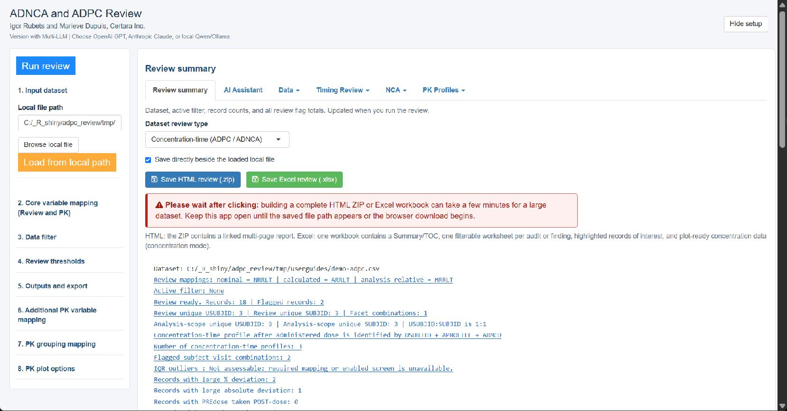
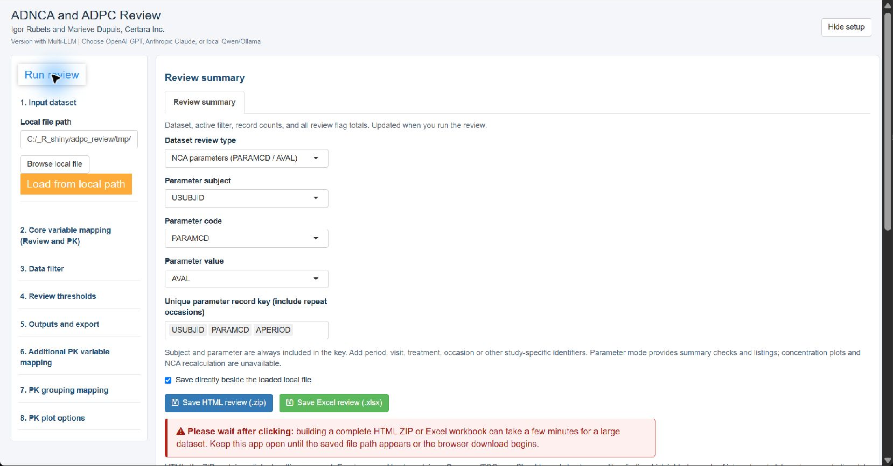

# adpcreview User Guide

**ADPC / ADNCA concentration-time and parameter-level review · version 0.1.0**

## Goals and intended inputs

Use adpcreview to inspect analysis concentration-time records, timing, profile structure, subject IDs and analysis flags, or to review a one-row-per-parameter NCA dataset such as PARAMCD/AVAL. The app title may say **ADNCA and ADPC Review**. Dataset names alone do not choose the correct workflow: some ADNCA files contain concentration records and others contain derived parameters.

Local `.xpt`, `.sas7bdat`, `.csv`, `.rds`, `.rda` and `.RData` files are supported when they contain a reviewable data frame. Variables are mapped to roles without renaming source columns. This app does not apply the strict raw SDTM PC contract; use pcreview for that task. It does not automatically reconcile a parameter dataset with independently recomputed NCA results.

## Choose your workflow

| Data shape | Choose on Review summary | Main use |
|---|---|---|
| Many timed concentration records per subject/profile | **Concentration-time (ADPC / ADNCA)** | Timing/quality checks, profile plots and separate PKNCA feasibility |
| One record per NCA parameter per subject/occasion | **NCA parameters (PARAMCD / AVAL)** | Parameter inventory, key/value/unit/label/flag checks and complete parameter listing |

### First concentration-time review

1. Launch the package. In Setup **1. Input dataset**, select the file and click **Load from local path**.
2. On **Review summary**, confirm **Dataset review type → Concentration-time (ADPC / ADNCA)**.
3. Expand Setup **2. Core variable mapping (Review and PK)** and confirm subject, analyte, visit, nominal/calculated/analysis-relative time and concentration.
4. Choose the Review data filter and screening thresholds, then click **Run review**.
5. Check source SHA256, loaded/selected/reviewed counts and findings. Open a summary item for the expandable context table.
6. Use Data and Timing Review for investigation; prepare PK profiles or run the separate NCA assessment when needed.
7. Save HTML/Excel review evidence from Review summary.



*Figure 1. Concentration mode with the left Setup panel. The records are invented demonstrations.*

## Install, launch and stop

### Install from GitHub

The public source repository is [irubets/adpcreview](https://github.com/irubets/adpcreview). Install directly from GitHub:

```r
install.packages("remotes", repos = "https://cloud.r-project.org")
remotes::install_github("irubets/adpcreview", dependencies = TRUE, upgrade = "never")
adpcreview::run_app()
```

Alternatively, download the supplied [adpcreview_0.1.0.tar.gz](https://github.com/irubets/adpcreview/raw/refs/heads/main/dist/adpcreview_0.1.0.tar.gz) source archive and follow the archive-installation steps below. Neither method requires a developer-machine folder.


You need R 4.3 or later, a web browser, and your dataset. RStudio is optional. Obtain **`adpcreview_0.1.0.tar.gz`** (or the supplied newer version) from the package maintainer. Keep the archive intact; you do not need the developer's source folder.

First install the dependencies from CRAN:

```r
install.packages(c(
  "shiny", "shinyWidgets", "shinyFiles", "DT", "plotly", "ggplot2",
  "dplyr", "tidyr", "haven", "readr", "openxlsx", "stringr", "purrr",
  "scales", "httr2", "jsonlite", "htmltools", "PKNCA", "zip", "digest"
), repos = "https://cloud.r-project.org")
```

Then install the supplied application archive. The file chooser avoids any machine-specific path:

```r
install.packages(file.choose(), repos = NULL, type = "source")
# Choose adpcreview_0.1.0.tar.gz in the dialog.
```

The two installation commands have different sources: dependencies come from CRAN; the app comes from the archive you received. Local archive installation does not fetch missing dependencies automatically. This guide does not assume the application itself is published on CRAN. The app package contains no native C/C++ code; dependencies built from source may need platform-specific development tools. On Windows, use CRAN's available binary dependencies when possible.

Start the app from any working directory:

```r
adpcreview::run_app()
```

A browser opens a local Shiny app. Leave R running while using it. If a browser does not open, copy the `Listening on http://127.0.0.1:...` address printed by R. To select a port explicitly:

```r
adpcreview::run_app(port = 3838, launch.browser = TRUE)
```

Stop with RStudio's **Stop** button or **Esc**, or **Ctrl+C** in a terminal. Closing the browser alone may leave the R process running. Restart R before reinstalling an app that is currently loaded. Reinstall after receiving an updated archive; verify with `packageVersion("adpcreview")`. Run the two apps in separate R sessions if you need them simultaneously.

To reopen this offline guide after installing the documented package:

```r
browseURL(system.file("docs", "USERGUIDE.html", package = "adpcreview", mustWork = TRUE))
```

### What is stored where?

Input datasets stay where you select them. Review transformations are in-memory; the app does not overwrite the source file. Reports are saved using the controls described below. Named AI subsets are temporary session snapshots. Approved generated visualizations default to a writable per-user app-data folder, rather than the installed package library; you can choose another folder with `run_app(output_dir = "my-visualizations")`. Neither AI credentials nor clinical datasets are supplied with the package.

## Understand scopes and action buttons

The left panel is **Setup**. Use **Hide setup** to make more room for results, and **Show setup** to restore it. Expand a numbered section to see its controls. Hiding or collapsing a section is a display choice; it does not remove records.

| Work area | Starting data and controls | Button that commits the work |
|---|---|---|
| Review summary and timing review | Loaded data, shared mappings, Setup data filter and review thresholds | **Run review** |
| Individual/group PK profiles | Loaded data with the separate **PK record filter (independent of Review)**, shared mappings and plot options | **Prepare / Update PK Profiles** |
| SAS-style plots | Plot preparation and tab-specific selections/mode | **Generate Plots**, after preparing PK profiles as needed |
| PKNCA feasibility | Loaded data, its own record filter, profile mapping, interval and AUC method | **Run PKNCA assessment** |

Always read each area's record count and scope description. A Review filter does not automatically become the PK or NCA filter. Table search, column filters and page controls generally change the displayed listing; they do not redefine the committed whole review. Saving a named AI subset deliberately captures the current Review selection.

After changing Review mappings, filters or thresholds, click **Run review** again before interpreting results or exporting. After changing PK preparation settings, click **Prepare / Update PK Profiles**. Changing only a display selector is different from rebuilding its underlying data. Rerun an NCA assessment after changing its relevant settings.

## Left Setup panel: what each choice does

### 1. Input dataset

Use **Browse local file** or enter **Local file path**, then click **Load from local path**. Loading and running review are separate actions. The source-file SHA256 is captured at load and checked before/after reading. Reload a file after editing it; a new fingerprint is not created merely by changing a filter.

### 2. Core variable mapping (Review and PK)

| Role | Common names | Confirm before review |
|---|---|---|
| Subject ID | USUBJID, otherwise SUBJID | Use the intended subject key; inspect the ID mapping audit. |
| Analyte | ATEST or PCTEST | Keep analytes scientifically distinct. |
| Analysis Visit / optional visit code | AVISIT / VISITCD | Must identify the correct visit context. |
| Nominal Time | NRRLT or NFRLT | Planned/bucketed elapsed time, not an arbitrary ordering code. |
| Calculated Relative Time from Dose | ARRLT or AFRLT | Observed elapsed time used by timing screens. |
| Analysis Relative Time | MRRLT or MFRLT, optional | Analysis-adjusted time; differences can be intentional. |
| Concentration | AVAL | Numeric concentration in consistent units. |
| Sample/reference timestamps | ADTM, ARFTDTM/PCRFTDTM, optional | Context supporting the analysis-time variables. |

The app does not turn raw PC datetime strings into ADaM time variables in this mode. Supply and map the analysis variables appropriate to the study. Confirm all mapped times use compatible units. The legacy timing engine excludes missing analyte/visit or nonfinite nominal/calculated time; the summary’s excluded-record audit and source-quality checks keep those selected source rows visible. No source result is silently imputed.

In parameter mode, use the parameter controls on **Review summary** instead. The concentration mappings/thresholds in Setup do not become parameter rules.

### 3. Data filter

Choose whether to apply a Review filter, then select the variable and value (including the null/empty choice where offered). This can isolate an analysis population or a study-specific subset. Click **Run review** to commit it. Check both loaded and retained row counts; a filtered subset is not the whole dataset. This panel does not select the separate PK-profile or NCA populations.

### 4. Review thresholds

| Control | Meaning and initial value |
|---|---|
| Large percent deviation threshold | Flag `100 × abs(calculated − nominal) / abs(nominal)` strictly above **20%**. Nominal zero has no percent deviation. |
| Large absolute deviation threshold | Flag `abs(calculated − nominal)` strictly above **0.5**, in the mapped time unit. For standard PC-derived elapsed times that is hours. |
| Run optional IQR outlier test | Initially off. Compares actual timing within analyte/visit/nominal-time groups; it is not a concentration outlier test. |
| IQR multiplier | Initially **1.5**; shown when the optional screen is enabled. Insufficient groups cannot establish an outlier. |
| Suspicious PREdose threshold | Initially **−0.5**. Flags nominal zero with calculated time below that value. |
| Facet overview: panels per row | Initially **3**; controls layout, not population or detection thresholds. |

These are configurable screening defaults, not protocol-defined acceptance limits. Confirm time units and sampling rules before interpretation. Equality at an absolute/percent threshold does not trigger its strictly-greater-than rule.

### 5. Outputs and export

**Enable outputs** selects the legacy Excel listing and the concentration, group, facet, focused-time and subject-profile displays. Re-enable a display here if its corresponding plot appears unavailable. **Save Excel listing** is the smaller listing export. The complete HTML ZIP and Excel review reports are separate buttons on **Review summary**, not substitutes for these output choices.

### 6. Additional PK variable mapping

Core subject, analyte, visit, time and concentration mappings are shared with Section 2. Map available optional fields such as LLOQ and sex here; an unmapped optional field is not invented. These selections support the dedicated PK profiles, rather than changing the source values.

### 7. PK grouping mapping

Map available route, treatment, arm, cohort, age-group and BSA-category fields when they genuinely exist in the supported source. These are grouping/display choices, not dose derivations. Leave unsupported fields unmapped. In the strict SDTM PC app, many demographic/treatment variables are intentionally unavailable because they are outside its PC source contract; do not put ADaM-only fields into PC just to populate a graph.

### 8. PK plot options

Choose nominal/bucketed or analysis-relative time for the PK X axis, and linear or log10 concentration scale. Use linear scale to inspect zero values; a log scale cannot represent a literal zero. The profile displays mark zero values with triangles where supported and do not automatically substitute values for BLQ. Prepare/update the profiles after changing preparation settings.

## Review summary: the review’s starting point

Confirm the dataset identity, selected filter, row counts, subject/profile interpretation and source SHA256 first. Follow a linked finding into its complete available profile context; count highlighted triggers separately from all displayed records. Read missing-input requests even when a finding has no rows. Use the HTML/Excel buttons here for complete linked reports.

The ADPC report is a snapshot of the last successful Run review, including mappings, scope and thresholds. Pending control edits do not relabel the old report. Concentration mode adds source-quality checks for missing identifiers, values/times, nonfinite results, negative concentrations, source duplicates, units and flags. Disabled/missing prerequisites are Not assessable. The PC app’s C01–C20 protocol/dose/model suite is not assumed present here.
## Parameter-level NCA review

After loading, choose **Dataset review type → NCA parameters (PARAMCD / AVAL)** on **Review summary**. The app suggests this mode when it finds PARAMCD without recognized concentration-time fields; confirm it explicitly if names or data structure are unusual.

1. Choose **Parameter subject**, **Parameter code** and **Parameter value** (typically USUBJID, PARAMCD and AVAL).
2. Confirm **Unique parameter record key (include repeat occasions)**. Subject and parameter are always included. Add APERIOD, AVISIT, treatment, timepoint, date or other occasion fields required by the analysis specification.
3. Set the optional Setup data filter if the review should use only selected records.
4. Click **Run review**. Concentration-only navigation is hidden; parameter review stays in Review summary.
5. Open the inventory, full listing and linked findings, then save complete HTML/Excel reports.

For example, USUBJID + PARAMCD is insufficient if the same subject legitimately has CMAX in two periods. Add APERIOD to distinguish those records. Conversely, adding a unique sequence number to every key can conceal the repeated parameter records you intended to detect. Choose the scientifically meaningful key, not just a key that happens to be unique.



*Figure 2. Parameter mode has its own mappings and record key. It retains all selected rows, including missing results.*

| Finding / section | Interpretation |
|---|---|
| Parameter inventory | Counts observed mapped parameter codes, including missing codes; it does not know the expected protocol inventory. |
| Complete parameter data | Every selected source record, without concentration-time filtering. |
| Missing identifiers | Blank/missing mapped subject or parameter keys need investigation. |
| Missing or nonfinite analysis values | Missing, nonnumeric, NaN or infinite mapped results are screened without imputation. Missingness can be intentional. |
| Repeated analysis key | All records sharing a repeated committed key are retained for adjudication. |
| Exact duplicate source records | All source values compare equal; copies are not removed. |
| Missing / inconsistent analysis units | Missing AVALU/PARAMU or multiple units within one parameter code; all involved candidates are shown, with no guessed conversion. |
| Missing / inconsistent parameter labels | Missing PARAM or multiple labels per parameter code. No authoritative dictionary is inferred. |
| Nonstandard analysis flag values | Populated ANLnnFL, NCAnnFL or PKSUMXFL values other than Y/N, case-insensitively. Blank values may be intentional; APROFILE is not forced to be binary. |

There is no universal positivity/range test for every NCA parameter, no expected-parameter completeness check without a study specification, and no automatic eligibility adjudication. Parameter mode does not recalculate NCA from derived parameter rows. Its Excel export contains parameter listings rather than a concentration Plot data sheet. Load concentration-time data and use the separate NCA workflow if feasibility calculations are required.


The following Data, Timing Review, PK Profiles and NCA sections describe **concentration mode**. Parameter mode uses the summary sections described above and hides those concentration-only tabs after review.

## Data menu: inspect records and review context

### Case explorer

Find cases with timing criteria or available CRIT/NCA/ANL/PKSUM flags. Select **Case definition** (Auto, subject + analyte + visit, or subject + profile), optional **Subject contains** text and plot time. The three combination choices answer different questions:

- **Any criterion (OR):** at least one criterion matches.
- **All on same record:** a single row must satisfy all selected criteria.
- **All somewhere in case:** different rows in the same case may satisfy different criteria.

The **Cases** subtab lists matching cases; **Records** lists their underlying rows; **Concentration–time profiles** draws the selected cases up to **Maximum profile figures**; **AI case context** previews optional bounded context. Use the CSV buttons for cases or records. A limit on displayed figures is not a limit on the matching-case population. Confirm blinding before enabling external AI case context; do not assume a source filename proves blinding.

### Grouping values audit

Three subtabs separate the audits. **Grouping values** lists available factors, their values and missing-variable/consistency warnings, with CSV export. **Profile time points** shows the selected profile grain, candidate-key assessment, nominal-time cycles and planned timepoint listings. **Subject ID mapping** checks available USUBJID/SUBJID pairs in both directions and shows exceptions/missing identifiers. Missing required audit fields mean unavailable, not a successful audit. Observed categories are not an authoritative study dictionary.

### Review finding subsets

Open an individual timing or quality finding to inspect all available records in the affected concentration-time profiles. Trigger rows are highlighted; unhighlighted rows provide context. Read the count of triggering records separately from the number of profiles and the number of displayed rows. Per-finding CSV exports retain this context. No matching rows alone does not establish that a rule was assessable.

### Data preview

**Raw input** inspects loaded source data. **Derived review** inspects the working review listing. Previews can show a bounded number of records; use full report exports or the appropriate complete listing when a complete population is needed. Derived review values should not be mistaken for new source variables.

### Analysis population flags

Select available analysis/criterion flags. **Definitions and counts** shows meanings and frequency summaries; **Combinations** tabulates joint flag patterns; **Pairwise comparison** compares two flags; **Potential issues** highlights alias/value inconsistencies; **Record drill-down** filters actual records by selected flag values. A flag name is not proof of its study-specific derivation; confirm the analysis specification. APROFILE may contain a profile label rather than a Y/N inclusion flag.

## Timing Review menu: understand when samples were collected

These tabs use the concentration-time Review population and are available after **Run review**. Labels such as ARRLT/MRRLT/NRRLT refer to the mapped roles shown by the app; do not assume every study uses those literal source names.

| Tab | Purpose and principal choices |
|---|---|
| **Review listing** | Inspect timing flags, reasons and deviations row by row. Choose only flagged records or all records, optionally restrict to a selected focus combination, and use minimum/maximum percent-deviation filters. These listing controls also define the selection used by a saved AI subset. |
| **Conc vs Time** | Overview of concentration against time. Switch AVAL versus natural log `ln(AVAL)` and optionally show flagged points only. Use hover and selection to connect points with records. |
| **Conc vs Time by Group** | Select analyte and visit, then compare concentration-time patterns by available mapped groups. The scale and flagged-only choices change the display. |
| **Facet overview** | Compare timing distributions across analyte/visit/nominal-time panels. Select calculated time, analysis-relative time, or either time minus nominal. Optionally overlay points and show flagged overlay points only. |
| **Facet overview by Group** | The same timing comparisons split by available group context, for a selected analyte and visit. |
| **Focused view** | Select one analyte, visit and nominal time; inspect its timing distribution and optionally flagged records only. Useful for a suspicious scheduled sampling point. |
| **Subject profile** | Select subject, analyte and visit; choose nominal/calculated/analysis-relative X time and concentration or natural-log Y. Reference markers and flagged-point labels support comparison of collection order with intended time. |

Use Previous/Next or page controls where offered; pagination changes what is rendered, not the underlying reviewed population. Natural-log and log10 displays are different transformations; read the selected label.

## PK Profiles menu: dedicated concentration displays

These displays have their own **PK record filter (independent of Review)**. It can retain all loaded records or apply one variable rule: equal to a value, empty/null, or filled. Confirm the retained/loaded counts, then click **Prepare / Update PK Profiles**. Repeat preparation when mappings or preparation filters change.

### Individual Subject Profiles

Choose analyte, subjects and available line-colour grouping. **All** selects subjects; **Clear** clears the selection. Use **Focus on a time range** for a smaller X-axis interval, choose one enlarged/four/six profiles per page, and navigate pages. Read warnings about confounded groups or unsuitable keys instead of treating every line as a verified dose episode.

### Profiles by Groups

Choose analyte, grouping mode, visit and treatment where available. Modes organize all subjects at one visit or related visit/treatment comparisons. Only real mapped groups are available. Prepare/update the data before using group selectors; group labels do not perform a unit conversion or pool scientifically incompatible analytes.

### SAS-style Spaghetti Plots

This is a plotting-layout name; SAS software is not required. Confirm **Dataset domain**, X-axis variable and linear/log10 Y scale. There are six modes:

1. **Subject + Visit + Analyte:** one selected combination.
2. **Subject + Visit, all Analytes:** compare analytes for one subject/visit.
3. **Subject, all Visits + Analytes:** review one subject across visits/analytes.
4. **Full batch:** generate the full configured collection of panels.
5. **All Subjects, page by Visit + Analyte:** compare subjects within each visit/analyte page.
6. **Analyte + all Subjects, page by Visit:** keep an analyte and compare visits across pages.

In modes 5/6, choose individual-subject spaghetti, **Mean with SD dispersion band**, or **Mean with SD error bars**. Summary modes can group by overall, arm, treatment, cohort or route when mapped, and provide descriptive concentration tables in a Phoenix-style layout. SD describes dispersion; it is not a confidence interval or an acceptance limit. **Upper only** versus two-sided SD and **Horizontal jitter** affect drawing, not the numeric source times. Overall summaries do not need group separation. **Combine visits** requires choosing compatible visits and reviewing the combined-axis diagnostic. A focused time range restricts the displayed interval. Click **Generate Plots** after changing these settings.

## NCA menu: feasibility from concentration-time records

Open **NCA Feasibility by APROFILE**. This performs a separate PKNCA assessment on supplied concentrations and times; it does not validate previously derived NCA parameter values against an ADNCA dataset.

1. Expand **Profile mapping** and confirm subject, analyte, profile and any additional keys, time and concentration.
2. Set the independent NCA filter: no filter, equal to a selected value, null/empty or filled. Read the number selected from the loaded dataset. Only one filter variable is applied at a time.
3. Choose **Interval start**, **Interval end** (number or `Inf`) and **AUC method** (lin up/log down, linear or lin-log). Confirm that time units and interval make sense for the study.
4. Click **Run PKNCA assessment**. Inspect missing/duplicate times, negative/missing concentrations and terminal-phase eligibility messages.
5. Read all four result subtabs, then use **Export NCA assessment** if needed.

| Result subtab | What it is for |
|---|---|
| **Summary and profile** | Profile counts and calculability; select a summary row to inspect the actual input records/plot. |
| **Cases and messages** | Input problems, blockers, warnings and parameter-specific calculation messages. |
| **Parameters** | Requested results and their assessment status. A finite number is not automatic evidence of study validity. |
| **Terminal diagnostics** | Supporting terminal-fit information returned with the assessment. |

Missing concentrations remain missing in the submitted input and are omitted during calculation. Literal zero values are retained. No automatic BLQ substitution is performed. Records outside the selected interval are listed. Review completeness, dose context and study conventions independently. The main Review-summary report does not imply this button was run; use the dedicated NCA export for these separate results.

## AI Assistant: optional help, with explicit data scope

The ordinary data review, plots and reports work without AI. Choose the provider and supported reasoning option, then read the status/context summary before sending anything. OpenAI and Anthropic are hosted services; selected context leaves the computer. Qwen uses the configured local Ollama endpoint.

**Data available to Review chat** has three scopes: aggregate review summary; complete-query access to the whole loaded dataset; or complete-query access to a named saved subset. Save a subset by setting Review listing controls, naming the selection and clicking **Save current Review selection**. It is a snapshot for this app session and does not follow later listing edits. Whole-data and subset access require the displayed acknowledgment. Whole loaded data is a different scope from a filtered Review.

| AI subtab | Workflow |
|---|---|
| **Review chat** | Ask questions about the chosen context. Optional Case explorer matches require the additional blinding/context confirmations and bounded-case limits. |
| **Data query** | Request a table/result. A validated read-only plan is executed locally against the complete scoped data; only a complete result within the configured processing threshold is submitted for interpretation. Download the complete CSV or Excel result. Results are not silently sampled. |
| **Visualization studio** | Ask for visualization code, inspect the code and its selected local execution data, then explicitly approve before execution/saving. Generated code is validated, but human review remains necessary. Outputs go to the configured writable visualization directory. |

### Configure a provider

Use `file.edit(path.expand("~/.Renviron"))` in R to edit your user environment file, add the relevant settings, save it and restart R. Keep real credentials out of shared scripts, source archives and reports. Replace model placeholders with an identifier available to your own account or local installation; this guide does not promise current provider/model availability.

```text
# Optional hosted OpenAI
OPENAI_ENABLED=true
OPENAI_API_KEY=your-own-key
OPENAI_MODEL=your-available-model

# Optional hosted Anthropic
ANTHROPIC_ENABLED=true
ANTHROPIC_API_KEY=your-own-key
ANTHROPIC_MODEL=your-available-model

# Optional local Ollama
LLM_ENABLED=true
LLM_BASE_URL=http://127.0.0.1:11434
LLM_MODEL=your-installed-model
```

Configure only the providers you intend to use. Start Ollama and install the intended model separately for local inference. Use the bounded context preview and confirm appropriate blinding before external submissions. An AI answer does not adjudicate a clinical finding.

## Save and share review evidence

On **Review summary**, choose **Save HTML review (.zip)** or **Save Excel review (.xlsx)** after running a review. Initially, saving directly beside the loaded local file is selected. Existing filenames receive a numbered suffix. Clear that choice for the browser download workflow; your browser then decides where files go. If the source folder is read-only, use browser downloads. Keep the app open until its saved-path message appears or the download finishes.

**HTML ZIP:** extract the entire archive and open `index.html` in the extracted folder. Keep the topic files together: the summary and table of contents use relative links. The report includes evaluation rules/settings, source provenance, audits, findings, context tables and input requests. Large tables retain all rows but display them in pages.

**Excel:** start with **Summary**, follow its internal table-of-contents links, then filter the per-audit/finding Excel Tables. Amber records are the finding triggers; other rows supply context. Frozen headers make wide listings easier to read. In concentration mode, **Plot data** provides a flat table and series labels for native Excel scatter plots; no macros are required. Parameter-mode data, when supported, are provided as their own complete listing instead.

The complete review workbook is different from **Save Excel listing**, per-finding CSVs, AI-query downloads and **Export NCA assessment**. Use the output corresponding to the question you reviewed. Source-file SHA256 identifies the original file bytes, not a hash of the filtered table; changing filters does not create a new source fingerprint. Reload a changed file before reviewing it again.

Reports can contain subject-level source records. Share them using the same access controls as the input dataset. The package distribution is not a destination for reports, study datasets or credentials.

## Troubleshooting and a reviewer’s completion check

| Symptom | What to do |
|---|---|
| Dependency is missing at installation | Run the dependency installation block first, then reinstall the supplied archive. Check R version and library write permissions. |
| Browser says disconnected | Check that the R/Shiny process is still running. Restart the app if necessary; session-only subsets will need to be recreated. |
| No output after changing settings | Use the correct action: Run review, Prepare / Update PK Profiles, Generate Plots or Run PKNCA assessment. Read the current scope/status. |
| Plot or grouping choice missing | Check Setup output selection, core mappings, optional grouping mappings and whether the chosen fields exist in this dataset. |
| Zero values seem absent on a log plot | Switch to linear scale. Do not infer missingness from a log display. |
| No finding rows, or “Not assessable” | Inspect prerequisites and rule descriptions. Supply metadata where required; zero displayed rows are not proof of a complete clean review. |
| Save fails in source folder | Use browser downloads or a source copy in a writable location. Do not close the app during report generation. |
| HTML links fail | Extract the whole ZIP and preserve the folder structure before opening index.html. |
| AI is unavailable | Confirm the chosen provider’s settings, restart R after environment edits, and ensure the local service/model is running when using Ollama. Core review remains available. |

Before handing off a review, confirm the source identity, loaded/selected/reviewed row counts, mappings and time units; resolve or document missing prerequisites; inspect complete affected profiles rather than triggers alone; distinguish screening candidates from adjudicated errors; and save the report that corresponds to the completed run. If NCA was assessed separately, retain that export and its settings too.

## Guide scope and verification

This guide describes package version **0.1.0**, documented on **November 12, 2026**. Control labels and tab names were checked against the current application source. Screenshots use invented demonstration records only; they illustrate navigation and are not a clinical validation dataset. They may differ from your browser size/theme. Installed-package creation/server smoke tests and the documentation build were verified for this documentation release. No hosted AI calls were made for the guide.

## License

Released under the [MIT License](LICENSE.md). Copyright 2026 Igor Rubets and Marieve Dupuis.
